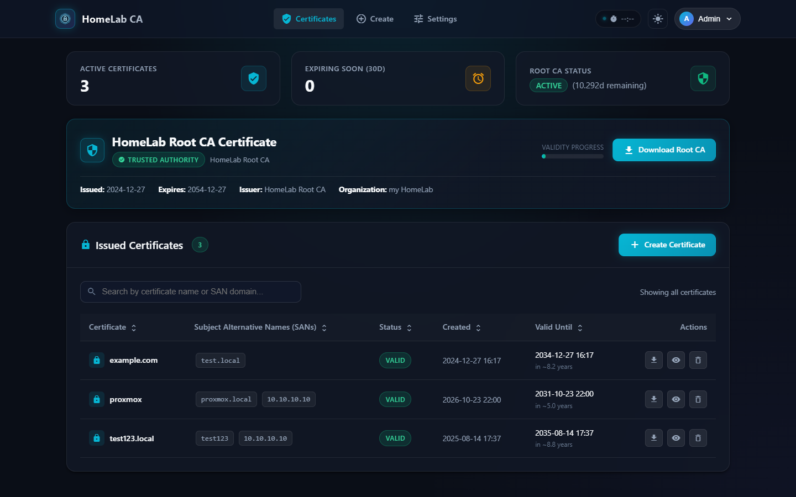
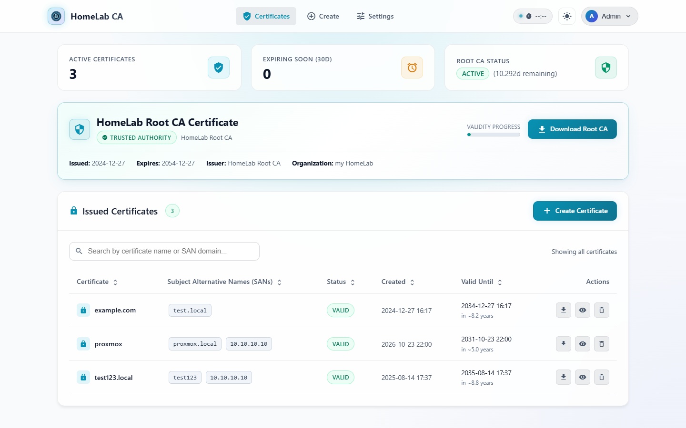
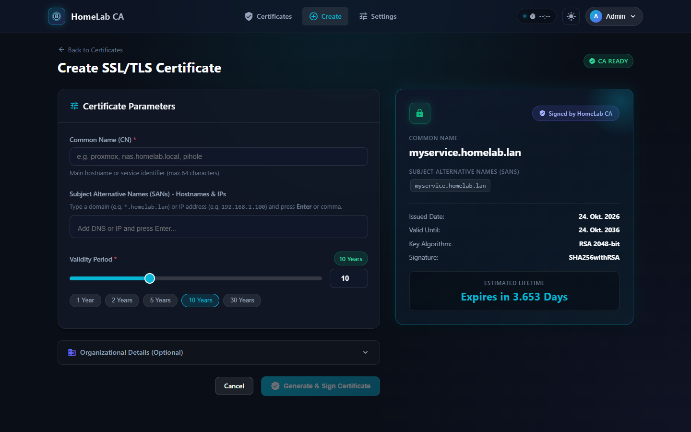
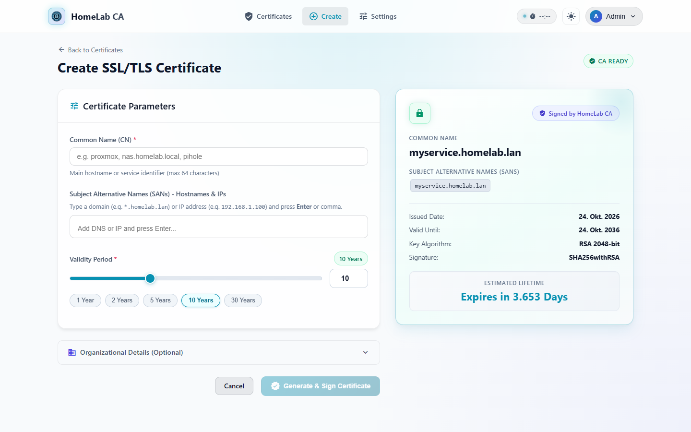
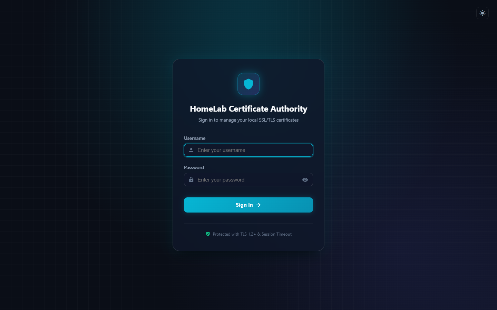
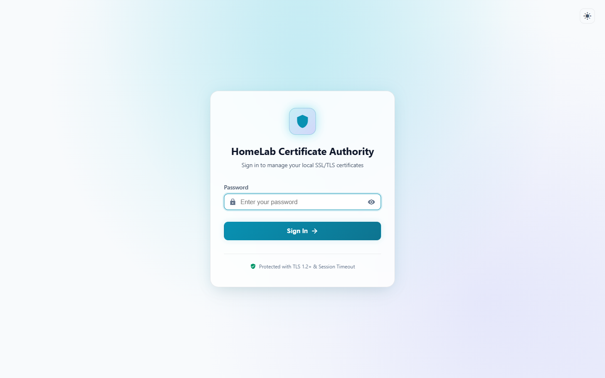

# Homelab Cert Manager

## Overview

Homelab Cert Manager is a Go project designed to manage SSL/TLS certificates for your homelab environment.
This tool can generate a Homelab Root-Certificate and additional certificates for your homelab-services like docker-containers or devices.

All you need to do is import and trust the generated Root-Certificate once to your PC and generate a new certificate for each of your services.

These certificates can then be used to configure SSL for or replace the self-signed cert of your HomeLAB services.

Then your internal sites show secure connections (without warnings) in all modern browsers.

## Features

- **Internal Certificate Management:** Generate and manage internal SSL/TLS certificates.
- **Configurable Session Timeout:** Inactivity timeout (1–30 minutes, default 2 minutes) with live top-bar countdown badge that automatically resets upon user activity.
- **Robust Security:** CSRF protection, brute-force login rate limiter, strong password policies, and path traversal prevention.
- **Hardened HTTP & TLS:** Modern security headers (HSTS, CSP, X-Frame-Options, X-Content-Type-Options), Slowloris protection, request body size limits, and TLS 1.2+ encryption.
- **4096-bit RSA Keys:** Strong encryption with 128-bit random serial numbers for all certificates.
- **Ease of Use:** Simple web interface for generating, viewing, and exporting certificates.
- **Dark/Light Mode:** Toggle between dark and light themes with preference persistence.
- **Search/Filter:** Easily search and filter certificates in the table.
- **Settings Page:** Configure certificate defaults, session timeout, and manage credentials.
- **PKCS#12 Export:** Export certificates in `.pfx` format for Windows and IIS services.
- **Unprivileged Container:** Runs securely in Docker under an unprivileged user (`appuser`, UID 10001).

## Screenshots

### Certificates Dashboard
| Dark Mode | Light Mode |
|:---:|:---:|
|  |  |

### Interactive Certificate Creator
| Dark Mode | Light Mode |
|:---:|:---:|
|  |  |

### Login & Authentication
| Dark Mode | Light Mode |
|:---:|:---:|
|  |  |

## Security Features

Homelab Cert Manager includes comprehensive security measures:

- **Session Inactivity Timeout:** Configurable between 1 and 30 minutes (default 2 minutes). A real-time countdown badge in the top navigation displays remaining time, seamlessly resets on user interaction, and invalidates session keys on server reboot.
- **Login Rate Limiter:** Protects against brute-force attacks by locking out an IP address for 5 minutes after 5 consecutive failed login attempts.
- **Password Security Policy:** Enforces strong passwords (8–72 characters, bcrypt hashed), forbids default credentials, and enforces a mandatory password change on first login.
- **CSRF Protection:** All forms and state-changing API endpoints require persistent, cryptographically secure CSRF tokens.
- **Path Traversal Prevention:** Sanitizes all user inputs and certificate filenames to prevent directory traversal attacks.
- **Root CA Protection:** Prevents unauthorized download or disclosure of Root CA private key files.
- **HTTP Security Headers:**
  - `Strict-Transport-Security` (HSTS) with 1-year max-age and subdomains
  - `Content-Security-Policy` (CSP)
  - `X-Frame-Options: DENY` (clickjacking protection)
  - `X-Content-Type-Options: nosniff` (MIME sniffing prevention)
  - `Referrer-Policy: strict-origin-when-cross-origin`
- **Cookie Security:** Cookies are configured with `HttpOnly`, `SameSite=Lax`, and `Secure` attributes.
- **Server & DoS Hardening:** HTTP server read, write, and idle timeouts mitigate Slowloris attacks, and request bodies are capped at 5 MB.
- **Secure File Permissions:**
  - Private keys: `0600` (owner read/write only)
  - Settings file (`data/settings.json`): `0600` (owner read/write only)
  - Certificates: `0644` (world-readable)
  - CA directory (`data/root-cert`): `0700` (owner only)
  - Data directories: `0750` (group readable)
- **Strong Cryptography:** 4096-bit RSA keys, 128-bit random certificate serial numbers, and TLS 1.2 minimum version.

## Getting Started

### Using Docker

To use Homelab Cert Manager, download and run the Docker image:

```bash
docker pull ghcr.io/cbrosius/homelab_cert_manager/homelab_cert_manager:latest
docker run -p 8443:8443 -v $(pwd)/data:/app/data ghcr.io/cbrosius/homelab_cert_manager/homelab_cert_manager:latest
```

The container runs as an unprivileged user (`appuser`) with the persistent `/app/data` volume.

### Building from Source

Alternatively, you can clone the repository and compile the project locally:

```bash
git clone https://github.com/cbrosius/homelab_cert_manager.git
cd homelab_cert_manager
go build -o homelab_cert_manager .
./homelab_cert_manager
```

### Initial Setup

When Homelab Cert Manager has started, navigate to `https://<IP-Of-HomeLAB-Cert-Manager>:8443`

1. Log in using **admin/admin** as initial Username/Password. You will be prompted immediately to set a secure password (minimum 8 characters).
2. Click **Create Root Certificate** to generate your HomeLAB Root CA.
3. Download the Root CA `.pem` file and import it into the Trusted Root Certification Authorities store on your devices.
4. (Optional) Replace the self-signed HomeLAB Cert Manager Certificate with a CA-signed one.
5. Create certificates for your internal servers, containers, or NAS devices.
6. Deploy the certificates (`.pem` / `.key` or `.pfx`) to your services.

## Configuration

### Session Inactivity Timeout

The session inactivity timeout can be customized via the **Settings** page under **Session Inactivity Timeout**:
- Valid range: **1 to 30 minutes** (default: **2 minutes**).
- A real-time countdown badge is displayed in the navigation header.
- Interacting with the application (mouse movement, clicks, keypresses, scrolls) resets the timer.
- Changes survive service restarts and are persisted in `data/settings.json`.

### Certificate Defaults

Default certificate attributes can be configured through the **Settings** page:

- Validity period (years)
- Organization & Organizational Unit
- Country (2-letter ISO), State, Location
- Email Address

### Debug Logging

To enable debug logging, add the following to `data/settings.json`:

```json
{
  "debug": true
}
```

Debug logging is disabled by default for security.

## File Permissions

The application ensures proper permission masks for all data:

| Path | Permission | Description |
| --- | --- | --- |
| `data/root-cert` | 0700 | CA private key storage (owner only) |
| `data/certs` | 0750 | Issued certificates |
| `data/certmanager-cert` | 0750 | Application's own certificate |
| `data/settings.json` | 0600 | Configuration file (owner read/write only) |
| Private Key files (`*.key`) | 0600 | Private keys (owner read/write only) |
| Certificate files (`*.pem`) | 0644 | Public certificates |

## Security Considerations

- Always access the application via HTTPS (TLS is enforced on port 8443).
- Change the default admin password immediately on first login.
- Keep the `data/root-cert` directory secure, as it contains your Root CA private key.
- Regularly back up the `data` directory — losing the Root CA private key will invalidate your PKI chain.
- The `data/settings.json` file contains password hashes and session configuration; never commit it to public version control repositories.

## License

See [LICENSE](LICENSE) file for details.
